# WeRead KOReader Plugin

> **免责声明**：本项目仅供个人学习和技术研究使用，不得用于商业用途。使用本项目所产生的一切后果（包括但不限于账号封禁、数据丢失等）由使用者自行承担，项目作者概不负责。请遵守微信读书的用户协议和相关法律法规。

在 KOReader 上阅读微信读书书籍、公众号文章的开源插件。支持分组书架、章节与全书下载、进度同步、阅读时长上报与统计；本地书也可关联微信读书书目，匹配查看划线和想法。让 Kindle、Kobo 等设备也能体验微信读书！

## 升级到更完整的微信读书？

除了本仓库的 **weread 开源版**，我也在开发 **weread 闭源版**：采用微信读书墨水屏 App 风格的界面，提供书城与推荐、离线阅读时长补报、划线与想法发布、评论和点赞，以及 AI 问书、联网百科、每周阅读奖励等功能。

**先在哔哩哔哩或小红书看演示；想请作者喝一杯咖啡、获取闭源版使用方式，请到闲鱼联系 finlater。** 闭源版需另行安装并激活，感谢你对个人开发的支持。

| 哔哩哔哩 · 看演示视频 | 闲鱼 · 请作者喝咖啡 | 小红书 · 看演示视频 |
|:---:|:---:|:---:|
| <a href="icons/bilibili.png"></a> | <a href="icons/xianyu.png"></a> | <a href="icons/xiaohongshu.png">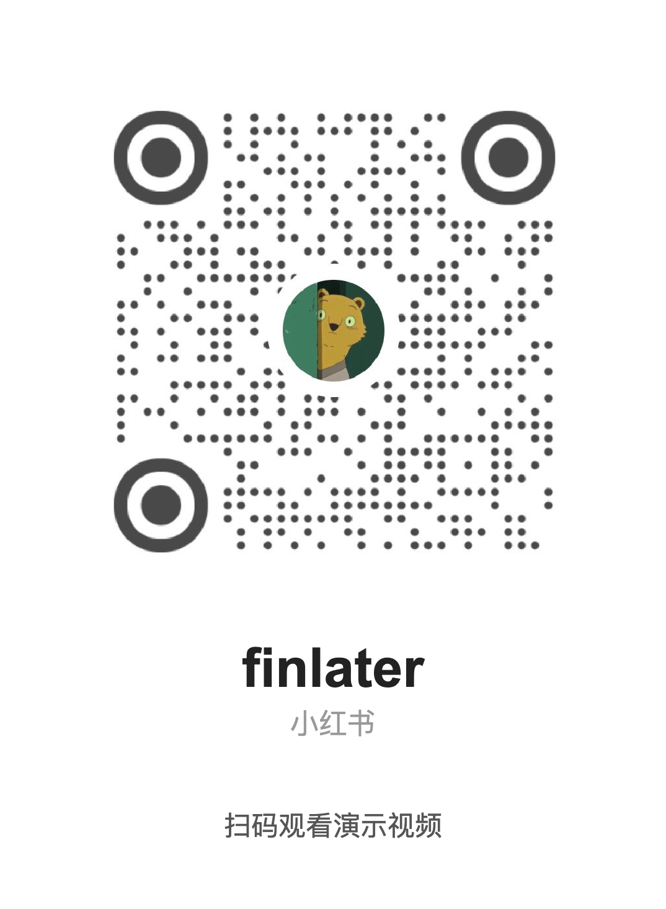</a> |
| [打开演示视频](https://b23.tv/eVFfl76) | 闲鱼昵称：**finlater** | 小红书昵称：**finlater**（小红书号：6793499788） |

<details>
<summary><strong>开源版与闭源版怎么选？点击展开功能对比</strong></summary>

**开源版已能离线读缓存书、同步进度、查看划线和想法，本地书也能匹配微信读书标注。** 喜欢 KOReader 的排版、词典、手势和本地书管理，可以继续使用开源版；希望在阅读器上逛书城、离线积累微信读书时长，或直接向微信读书发布划线、想法并参与互动，可以选择闭源版。

以下按开源版 v1.7.0 与闭源版 v1.1.0 已有能力整理。联网同步、内容获取及互动仍受账号权益、网络和微信读书服务影响。

| 功能 | weread 开源版（本项目） | weread 闭源版 |
|:---|:---|:---|
| 阅读界面 | 使用 KOReader 阅读器及其排版、手势、词典等功能 | 微信读书墨水屏 App 风格的独立界面 |
| 书架浏览 | 分组筛选、排序、搜索；自适应封面 / 列表、分页 / 连续滚动；缓存后可离线浏览 | 书架、分组与阅读状态管理 |
| 书城 / 推荐 | 支持搜索书籍，无独立书城 | 支持书城、分类与推荐 |
| 下载与离线阅读 | 单章、多选章节、整本下载；全书支持断点续传；已下载内容可离线读 | 章节缓存、全书下载与离线阅读 |
| 后台预下载 | 可预下载下一章正文、划线和想法；位置匹配由用户手动触发 | 支持阅读缓存与离线下载 |
| 阅读进度 | 微信下载书支持章节与文内位置映射、双向同步、冲突选择；定位依赖文本匹配 | 支持章节与文内位置同步、云端进度选择 |
| 联网阅读时长 | 自动关联或手动选择上报书籍；30 / 60 秒间隔；可限定仅阅读时上报 | 自动记录并上报阅读时长 |
| 离线时长补报 | 暂不支持向微信读书补报离线阅读时长 | 离线记录，联网后补报 |
| 阅读统计 | 周 / 月 / 年 / 总计、历史周期、排行与偏好图表 | 个人页面展示微信读书阅读数据 |
| 查看划线和想法 | 下载书、本地书统一管理；按章获取与匹配、手动章节对应、中断续传；缓存后可离线查看 | 阅读中查看个人与书友想法、热门划线 |
| 想法阅读体验 | 长想法分页、Emoji、复制、物理按键；可调位置、宽高、字号、对比度 | 个人 / 公开想法列表、长内容详情与互动 |
| 发布划线 / 想法 | 可用 KOReader 本地划线和笔记，但不上传到微信读书 | 支持创建划线、写想法；离线保存后联网同步 |
| 评论 / 点赞 | 可查看已获取的内容，暂不支持发布评论或点赞 | 支持联网评论、回复与点赞 |
| 书评 / 热评 | 支持书籍详情、书评及回复查看 | 支持书评与评论互动 |
| 书签 / 读完状态同步 | 不支持同步到微信读书；可使用 KOReader 本地书签 | 支持同步到云端 |
| AI 问书 | 暂未集成微信读书 AI 问书 | 可围绕选中的书中文字提问；需联网且账号、书籍支持 |
| 词典 / 联网百科 | 可使用 KOReader 自带词典、维基百科等功能 | 内置微信读书联网百科查询 |
| 每周阅读奖励 | 暂未提供领取入口 | 查看并领取符合条件的奖励，以账号和当期规则为准 |
| 本地书籍阅读 | 可关联微信读书书目、上报时长、匹配划线和想法；保留原 EPUB 和 KOReader 笔记 | 以微信读书书架为主，本地文件需先导入微信读书 |
| 公众号文章 | 支持书架中的公众号书籍 | 支持公众号书籍、微信收藏文章和浮窗文章 |
| 快捷操作 | 手势 / 按键绑定书架、搜索、统计、同步进度、上报状态和继续匹配；SimpleUI / ZenUI 集成 | 自动翻页、四角长按快捷操作等 |
| 更新与登录 | 微信扫码、多设备登录；自动更新提醒、稍后提醒、跳过版本 | 微信扫码登录、插件内检查更新；另需设备激活 |

</details>

### weread 闭源版截图

| 书架 | 书城 | 我的 |
|:---:|:---:|:---:|
| 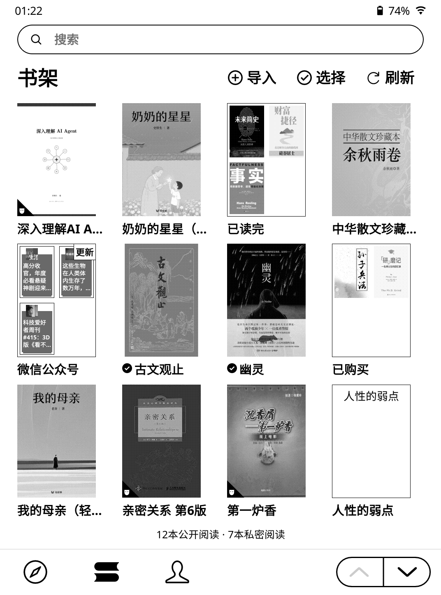 |  | 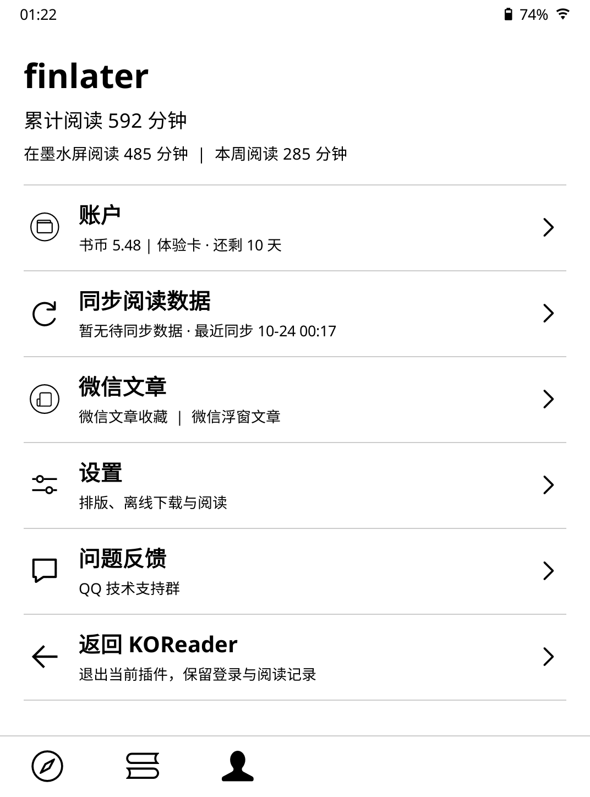 |

| 阅读界面 | 划线与写想法 | 书友想法与评论 |
|:---:|:---:|:---:|
|  |  |  |

weread 闭源版不包含微信读书会员或付费书籍；可阅读内容取决于你的微信读书账号权益。安装前请确认设备的 KOReader 版本及闭源版适配情况。

插件内可从 **微信读书 → 升级到更完整的微信读书？** 打开介绍；文件管理、阅读界面的微信读书一级菜单，以及 **设置 → 关于** 都将此入口放在第一项。介绍和二维码可离线查看，用手机扫码看演示或前往闲鱼；不能扫码时可搜索 **finlater**。

## 安装

> ⚠️ 建议使用 **KOReader 2026.03 或更高版本**。旧版本可能无法正常加载或使用插件，例如「工具」菜单中找不到「微信读书」。详见 [#14](https://github.com/finlater/weread.koplugin/issues/14)。

1. 前往 [GitHub Releases](https://github.com/finlater/weread.koplugin/releases) 下载最新的 `weread.koplugin-vX.Y.Z.zip` 安装包。
2. 解压安装包，得到 `weread.koplugin` 文件夹。
3. 将该文件夹复制到 KOReader 的 `plugins` 目录：

```
koreader/plugins/weread.koplugin/
```

4. 重启 KOReader，在菜单中找到：

```
工具 → 微信读书
```

后续更新插件可在 **微信读书 → 设置 → 更新管理** 菜单中在线更新。

## 登录与认证

插件只支持微信扫码登录，扫码前需要先为账号开通微信读书 Skill：

1. 手机打开**微信读书 App**。
2. 进入 **我 → 设置 → 微信读书 Skill**。
3. 点击 **获取 API Key**，确认已经生成个人官方 API Key。
4. 在 KOReader 打开 **工具 → 微信读书 → 微信扫码登录**。
5. 使用微信扫码并在手机端确认；若手机显示四位验证码，请在 KOReader 中输入。

## 功能

| 主菜单 | 书架 | 公众号 |
|:---:|:---:|:---:|
| 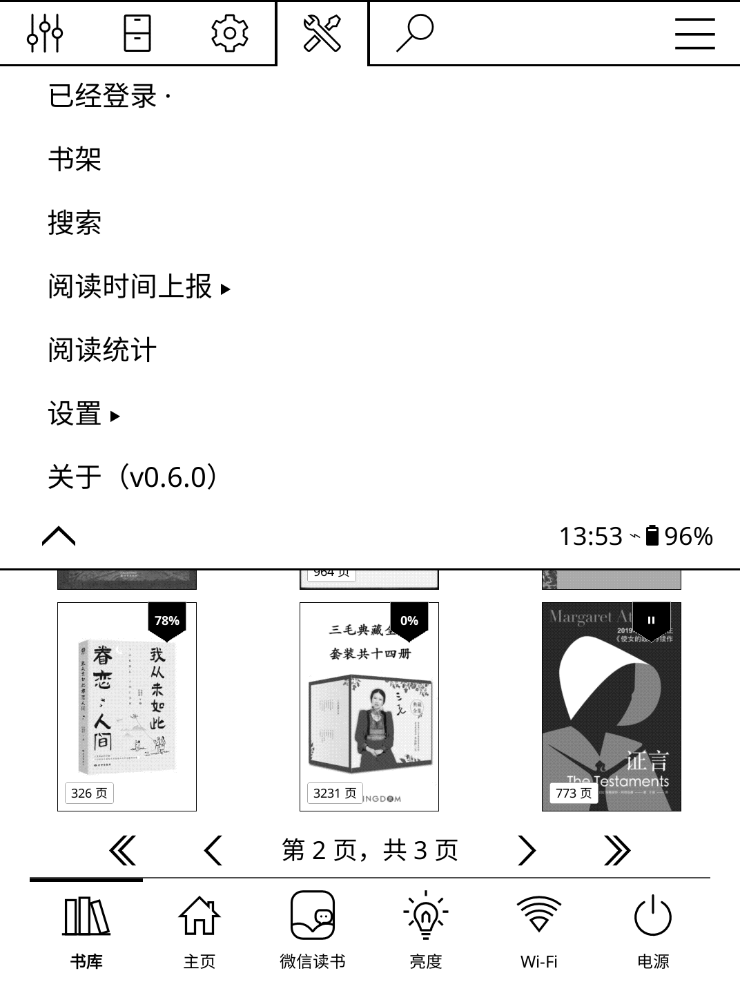 | 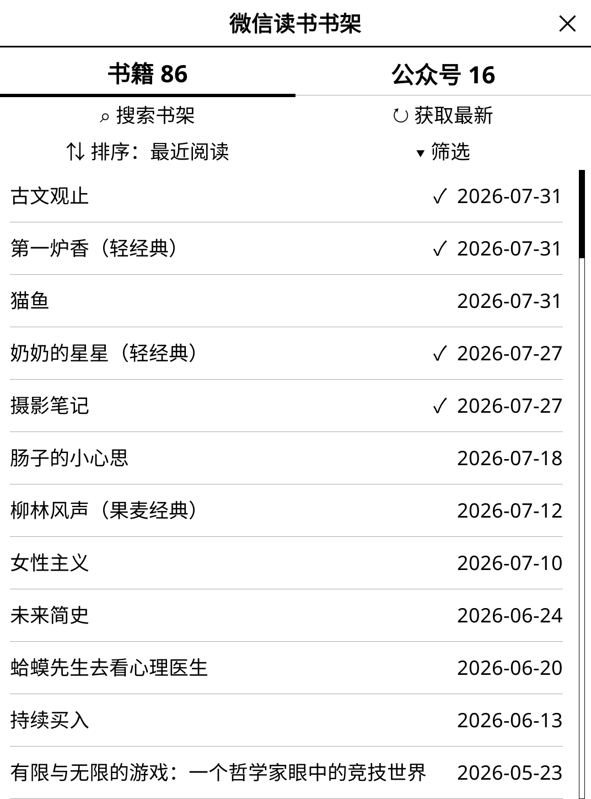 | 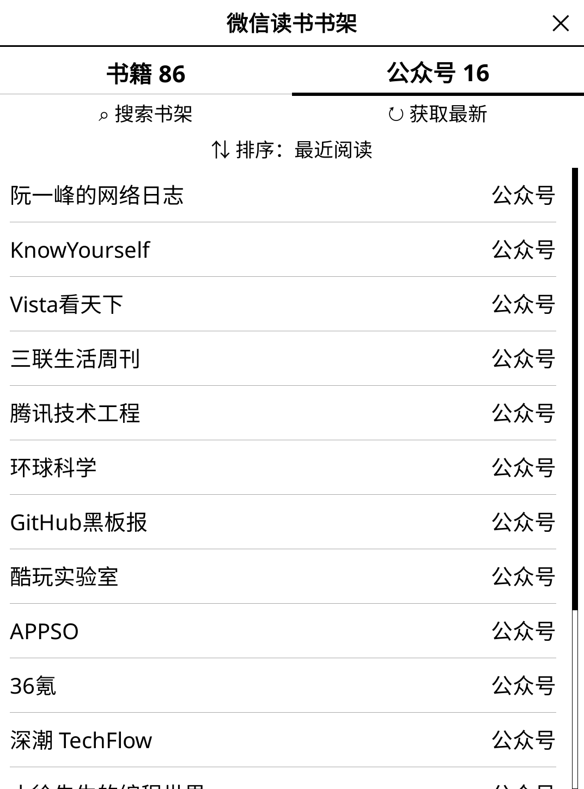 |

| 阅读时间上报 | 阅读统计 | 阅读进度同步 |
|:---:|:---:|:---:|
| 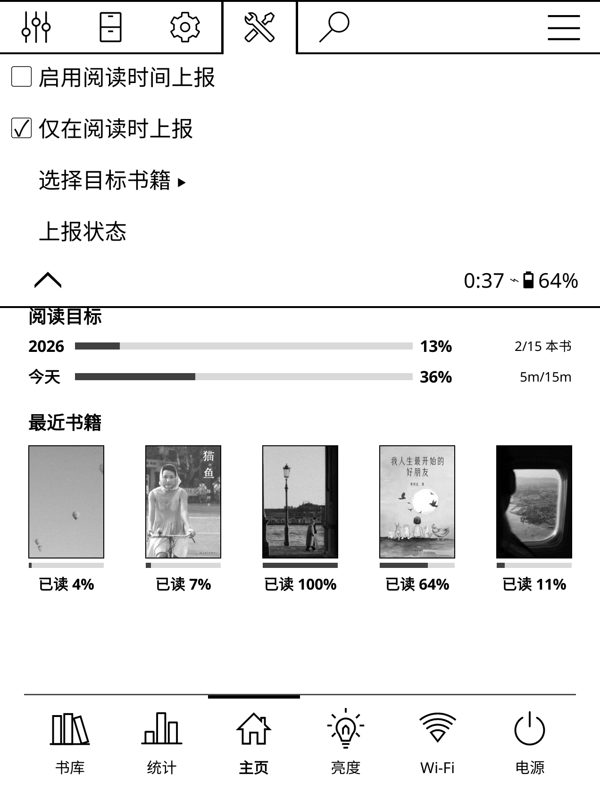 | 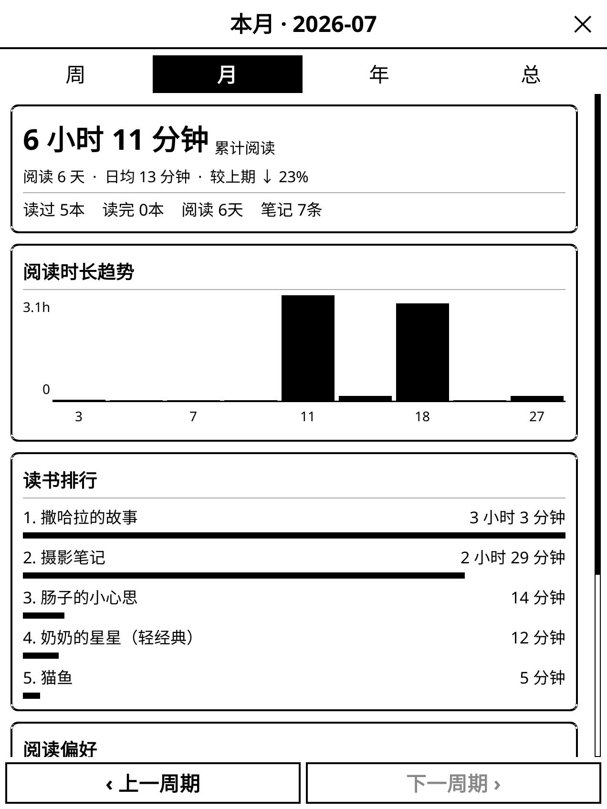 | 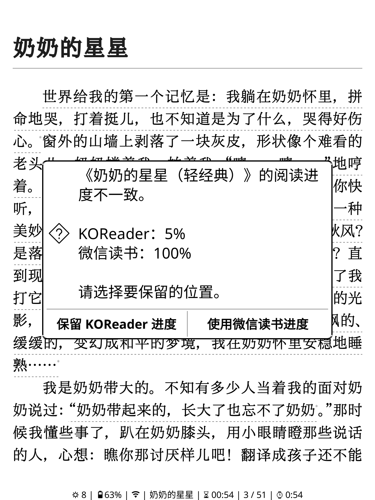 |

| 多选章节下载 | 章节预下载 | 下载全书 |
|:---:|:---:|:---:|
| 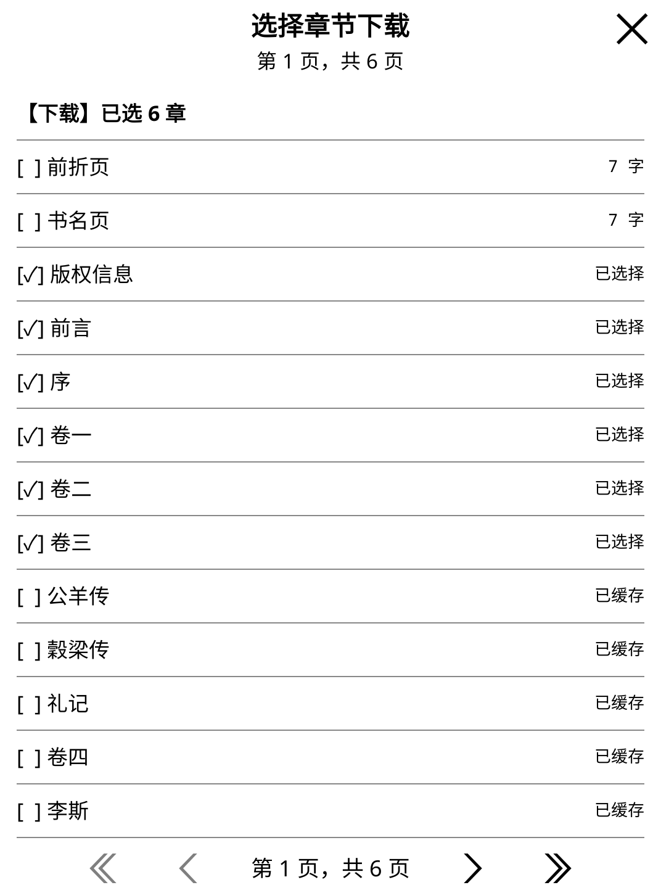 |  | 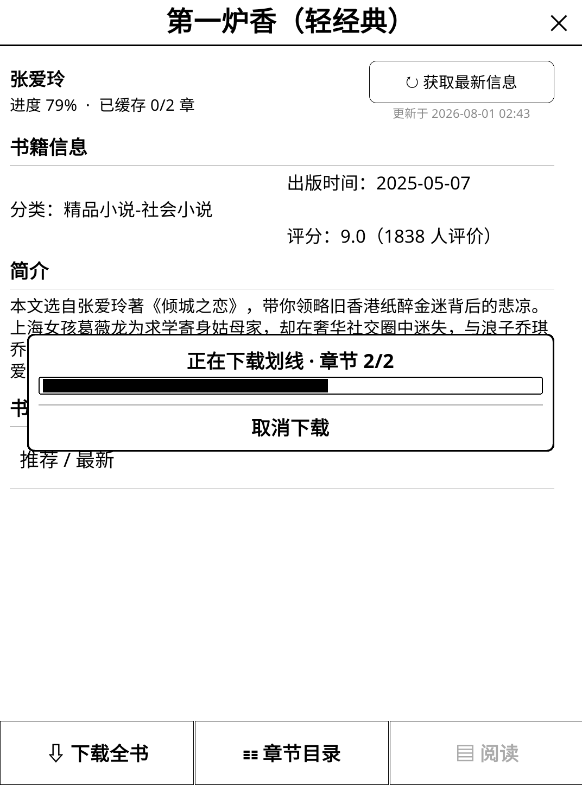 |

| 书籍详情 | 书评 | 划线和想法 |
|:---:|:---:|:---:|
|  |  | 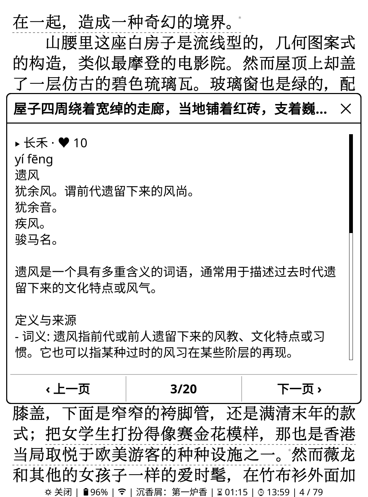 |

| 搜索书籍 | 快捷菜单 | 设置 |
|:---:|:---:|:---:|
|  | 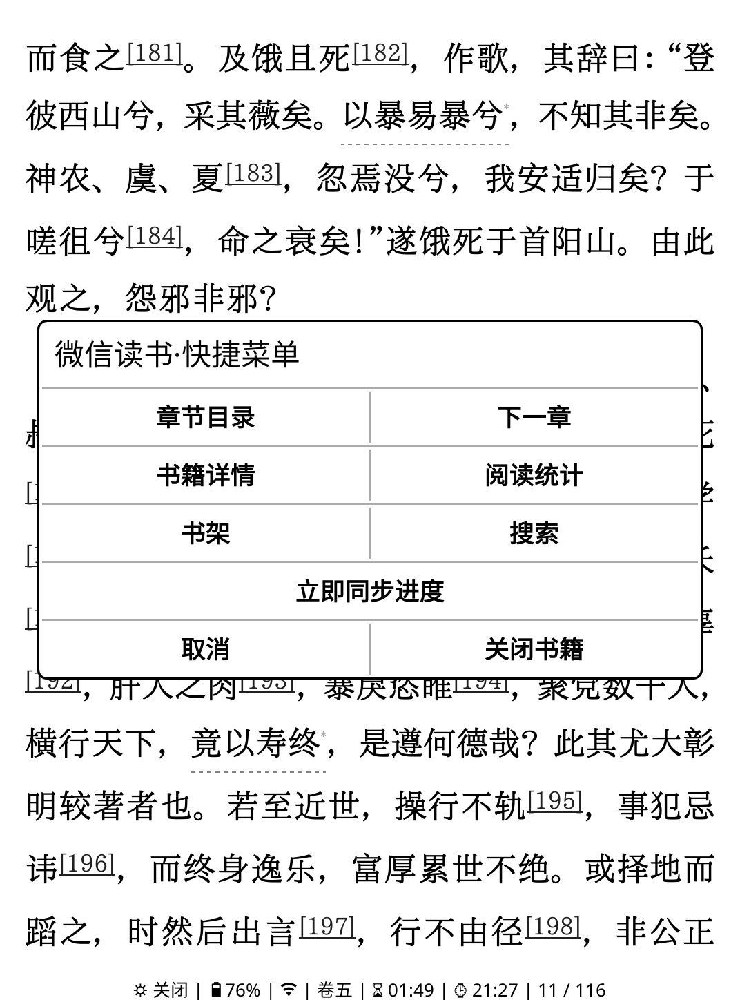 | 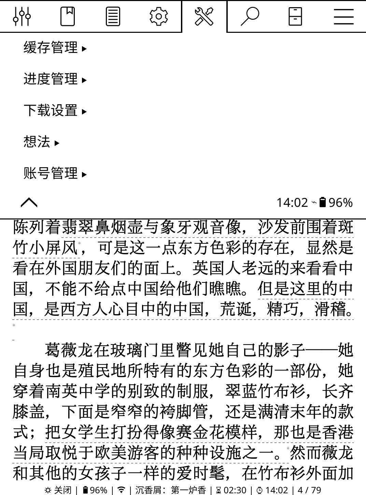 |


## SimpleUI / Zen_UI 集成

插件提供统一的“微信读书书架”入口并支持集成到 SimpleUI和 ZenUI的快捷按钮中。(需要安装最新版 [SimpleUI](https://github.com/doctorhetfield-cmd/simpleui.koplugin) 和 [ZenUI](https://github.com/AnthonyGress/zen_ui.koplugin)插件)。

- **SimpleUI**：进入 `快捷操作` 新建操作，类型选择 `插件 → 微信读书`，再把该操作加入底部栏即可。如需使用本项目图标，将 `icons/weread-w-book.svg` 或 `icons/weread-ink.png` 复制到 SimpleUI 的自定义图标目录`koreader/setting/simpleui/sui_icons`后，在快捷操作中选中它。
- **Zen_UI 底栏**：进入 `控件 → 按钮 → ➕ → 插件 → 微信读书`，点击后直接打开微信读书书架。注册时会把 `weread-w-book.svg` 同步到 KOReader 用户图标目录，供 ZenUI 自动匹配或手动选择；不会自动修改、添加或启用 Tab。
- **Zen_UI 首页**：进入 `主页 → 小组件`，启用“微信读书”组件。组件默认关闭，可由用户自行排序。

原生 KOReader 的 “工具 → 微信读书” 菜单保持不变。

|                     SimpleUI                     |                   Zen_UI                   |
|:------------------------------------------------:|:------------------------------------------:|
|  | 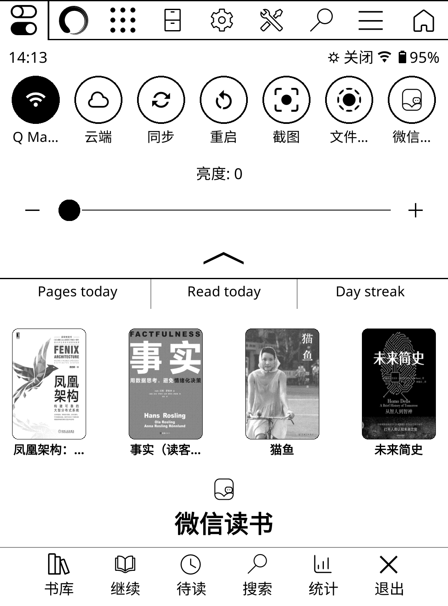 |

## 菜单结构

```
微信读书
├── 升级到更完整的微信读书？（weread 闭源版介绍、演示视频与闲鱼入口）
├── 微信扫码登录 / 已经登录 · 账号名
├── 立即同步进度       （阅读微信读书缓存书籍时显示）
├── 书籍详情           （阅读微信读书缓存书籍时显示）
├── 显示划线和想法     （阅读书籍时显示，开关）
├── 划线和想法管理     （本地书与微信下载书共用；不修改 EPUB/KOReader 笔记）
│   ├── 匹配微信读书书目 / 已关联微信书籍：书名（下载书自动关联）
│   ├── 继续匹配（手动续传、定位；开书仅显示已保存结果）
│   ├── 选择章节匹配（完整本地目录，可手动对应；勾选章节获取最新想法）
│   └── 清理划线和想法（再次匹配时下载最新数据）
├── 书架               单行顶栏：内容与分组 / 搜索 / 获取最新 / 菜单
│   ├── 内容与分组      书籍 / 公众号；书籍内选择微信读书分组，支持离线缓存
│   └── 菜单            排序、筛选、列表 / 封面；列表支持分页 / 连续滚动，分页支持滑动与按钮
├── weread收藏夹        已下载书籍（不包含单章）的本地入口
├── 搜索               搜索微信读书
├── 阅读时间上报        后台上报阅读时长
│   ├── 启用阅读时间上报
│   ├── 仅在阅读时上报
│   ├── 上报间隔
│   │   ├── 30 秒（默认）
│   │   └── 60 秒
│   ├── 选择目标书籍
│   │   ├── 自动关联微信读书书籍
│   │   └── 手动设置上报书籍
│   └── 上报状态
├── 阅读统计            阅读时长/天数/排行/偏好可视化（页内 周/月/年/总 tab 切换，可翻阅历史周期）
├── 设置
│   ├── 书架视图
│   │   ├── 列表模式（默认；适合连续滚动）
│   │   └── 封面模式（按屏幕自适应行列；仅加载当前页封面）
│   ├── 分页书架（仅列表模式；默认开启，关闭后使用连续滚动）
│   ├── 缓存管理
│   │   ├── 扫描并关联本地书籍
│   │   ├── 缓存清理
│   │   └── 缓存目录
│   ├── 进度管理
│   │   ├── 打开时拉取进度（默认关闭）
│   │   └── 关闭时上传进度（默认关闭）
│   ├── 下载设置
│   │   ├── 书籍图片（默认开启）
│   │   ├── 公众号文章图片（默认关闭）
│   │   ├── 隐藏脚注文本（默认关闭；开启需同时启用 KOReader 脚注弹框；仅影响新下载书籍）
│   │   └── 章节预下载
│   │       ├── 自动预下载下一章（默认关闭，后台下载）
│   │       ├── 预下载划线和想法（默认关闭；需同时开启总开关，位置匹配仍手动触发）
│   │       └── 显示预下载提示（默认开启，总开关关闭时不可操作）
│   ├── 划线设置
│   │   ├── 划线边缘防误触（默认开启）
│   │   ├── 边缘区域：20%（可调 10%–40%）
│   │   └── 想法弹窗设置
│   │       ├── 位置：居中（可切换为 底部）
│   │       ├── 高度：62%（可调 20%–90%）
│   │       ├── 宽度：80%（仅居中时可用，40%–100%）
│   │       ├── 字体大小（相对文档字号，默认 -2；可切换为绝对字号）
│   │       ├── 字体对比度：默认（可调 -3–+9，最大为纯黑）
│   │       └── 点击左右区域翻页（默认关闭，底部与居中弹窗均生效）
│   │   └── 想法弹窗宽度：80%（仅居中时可用，40%–100%）
│   ├── 账号管理
│   │   ├── 账号状态
│   │   ├── 立即续期 Cookie
│   │   └── 清除账号数据
│   ├── 高级选项
│   │   └── Mock 服务
│   │       ├── 当前生效环境
│   │       ├── 重启后启用 Mock（默认关闭，测试数据独立保存）
│   │       ├── 服务器 IP：192.168.31.111（可修改）
│   │       ├── 服务器端口：8765（可修改）
│   │       └── 测试连接
│   └── 关于
│       ├── 升级到更完整的微信读书？
│       ├── 版本 x.y.z
│       ├── 作者：finlater
│       ├── 检查更新
│       ├── 每小时自动检查一次（默认关闭）
│       └── 更新时优先使用代理（默认开启；代理失败会自动回退 GitHub）
```

## 贡献

欢迎提交 issue 和 PR。提交前请阅读 [CONTRIBUTING.md](CONTRIBUTING.md)。

XPointer 外部标注层仍是实验性功能，测试步骤和限制见
[原型说明](docs/xpointer-overlay-prototype.md)。

## 许可证

本项目代码采用 [GNU Affero General Public License v3.0](LICENSE)，SPDX 标识为 `AGPL-3.0-only`，与 KOReader 使用的许可证保持一致。

修改、整合或再分发本项目时，必须遵守 AGPL-3.0，保留版权和许可证声明，并按许可证要求将本项目代码或其衍生作品开源。

`fonts/NotoEmoji-Regular.ttf` 是第三方字体，采用 [SIL Open Font License 1.1](fonts/LICENSE)，不适用本项目的 AGPL-3.0。

Copyright © 2026 finlater and contributors.

## 项目推荐

| 插件 | 简介                                                  |
|------|-----------------------------------------------------|
| [kindlebtcontroller.koplugin](https://github.com/finlater/kindlebtcontroller.koplugin) | 蓝牙手柄/遥控器控制 Kindle —— 翻页、调节亮度、章节跳转等 20+ 操作，按键完全可自定义。 |
| [one.koplugin](https://github.com/finlater/one.koplugin) | 在 KOReader 上离线阅读「ONE · 一个」每日更新：一图、一文、一问答。           |
